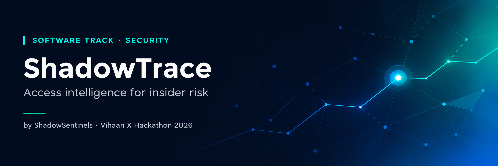
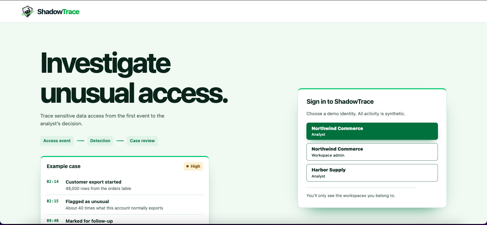
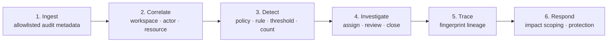
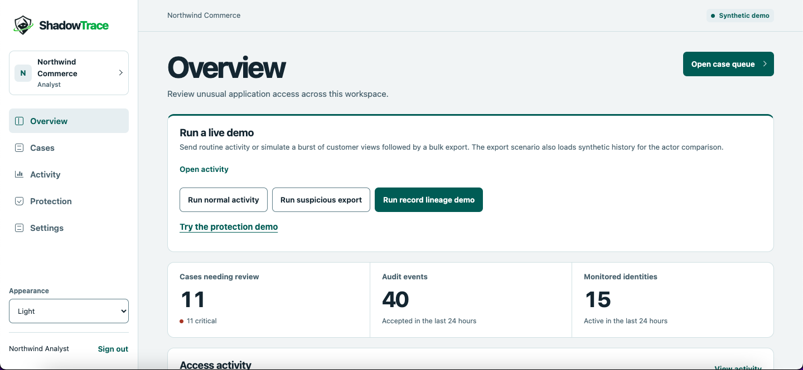
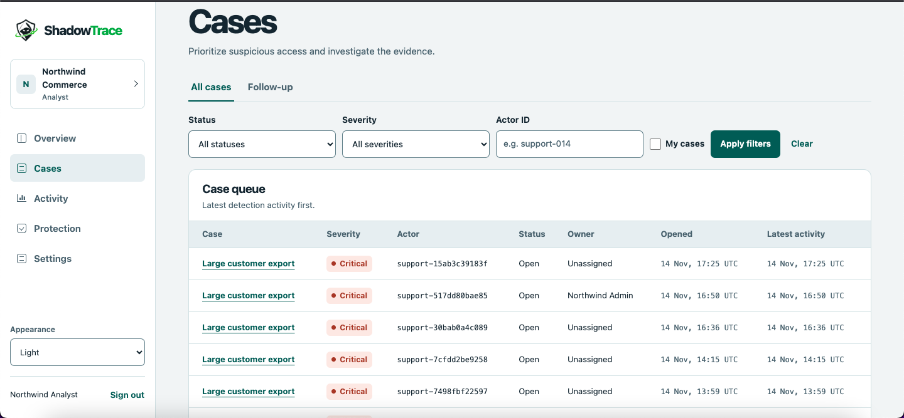
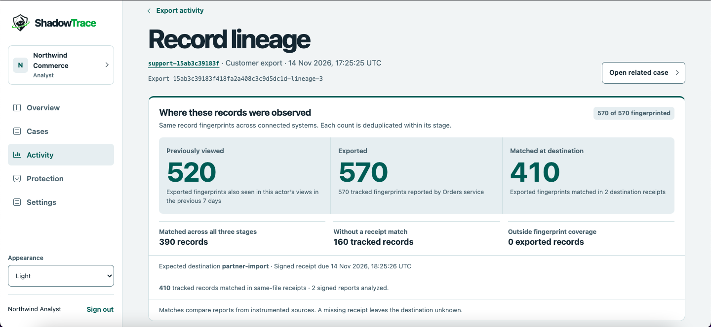
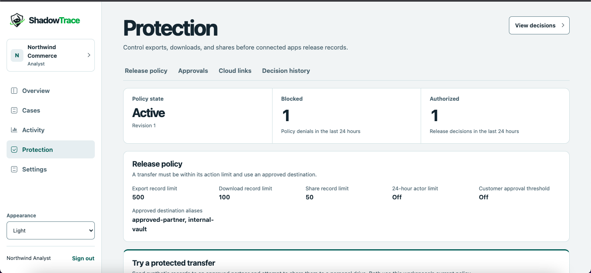
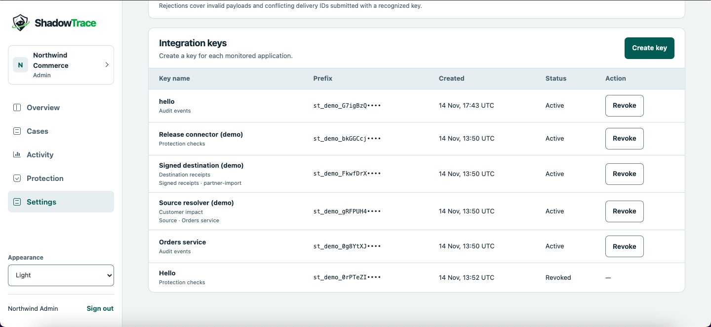
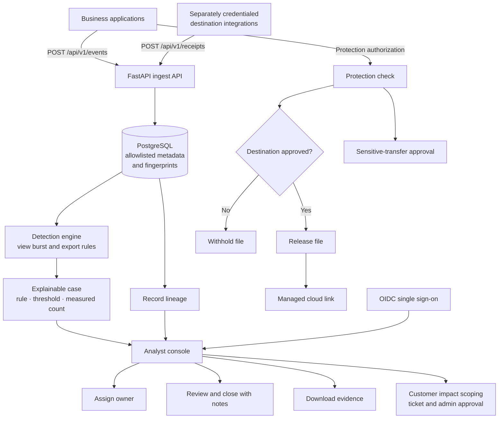

<div align="center">



<br>

# ShadowTrace

### Access intelligence for insider risk

**Turn sensitive-data access activity into explainable investigations,<br>without collecting raw business records.**

<br>

[](https://www.python.org/)
[](https://fastapi.tiangolo.com/)
[](https://www.postgresql.org/)
[](https://www.docker.com/)
[](#team)

**[The Idea](#the-idea-in-30-seconds)** ·
**[How It Works](#how-it-works)** ·
**[Product Tour](#product-tour)** ·
**[Live Demo](#live-demo-walkthrough)** ·
**[API](#api-integration)** ·
**[Security](#privacy-and-security)**

<br>

> ### Observe access. Connect the evidence. Investigate the risk.



</div>

<br>

## The idea in 30 seconds

Business applications already record who views and exports sensitive information. The problem: audit logs are **noisy, disconnected, and usually investigated only after a suspected leak.**

**ShadowTrace turns those events into an investigation workflow.**

| | |
|---|---|
| **Correlate** | Links unusual record-view bursts to the exports that follow |
| **Explain** | Creates cases that show the policy, rule, threshold, and measured count |
| **Trace** | Follows exported data across views, exports, and destination receipts using fingerprints |
| **Respond** | Scopes customer impact and supports approval and destination checks on transfers |
| **Stay private** | Uses allowlisted audit metadata and fingerprints, not raw record IDs or contents |

<br>

## Why ShadowTrace?

| Traditional audit-log workflow | ShadowTrace |
|---|---|
| Disconnected activity records | Correlated access and export signals |
| Manual log investigation | Explainable cases for analyst review |
| Limited visibility after export | Fingerprint-based record lineage |
| Sensitive data copied into investigation tools | Allowlisted metadata and fingerprints only |
| Reactive review | Configurable detection and supported transfer-protection workflows |

> [!NOTE]
> A ShadowTrace case is a **signal for human review**, not an automatic finding of misconduct.

<br>

## The problem

Consider an employee who views hundreds of customer records, then exports a large dataset. Each event may look legitimate on its own. In a raw audit log, the link between the **view burst → export → destination** is hard to see.

Investigators need to answer:

- Which actor accessed the records?
- Was there an unusual burst of views before the export?
- Which exported records had also been viewed earlier?
- Did a destination integration report receiving matching records?
- Which customers may be affected?
- Was the transfer allowed, withheld, or approved?

And the investigation itself can create another risk if it requires copying sensitive record IDs or contents into yet another system.

> **The challenge:** make access activity explainable and traceable *without* creating another store of the sensitive business data.

<br>

## How it works



| Step | What happens |
|:---:|---|
| **1. Ingest** | Business applications send allowlisted audit metadata to the event API. |
| **2. Correlate** | A burst of sensitive-record views and a subsequent export are grouped by workspace, actor, and resource. |
| **3. Detect** | Qualifying patterns become cases with the policy version, rule, threshold, and measured count. |
| **4. Investigate** | Analysts review actor history, assign ownership, add notes, and close cases. |
| **5. Trace** | Lineage compares fingerprints reported by earlier views, exports, and separately credentialed destination integrations. |
| **6. Respond** | Customer-impact scoping and supported protection workflows provide approval and destination checks. |

The workspace is derived from the integration key. Destination integrations are credentialed separately. Raw record IDs and record contents are not intended to be collected by the investigation service.

<br>

## Product tour

<table>
  <tr>
    <td align="center" width="50%">
      <b>Overview</b><br><br>
      
    </td>
    <td align="center" width="50%">
      <b>Case review</b><br><br>
      
    </td>
  </tr>
  <tr>
    <td align="center">
      <b>Record lineage</b><br><br>
      
    </td>
    <td align="center">
      <b>Active protection</b><br><br>
      
    </td>
  </tr>
  <tr>
    <td align="center" colspan="2">
      <b>API ingestion</b><br><br>
      
    </td>
  </tr>
</table>

<br>

## Key capabilities

<details open>
<summary><b>Detection and investigation</b></summary>
<br>

- Detects unusual access patterns, including a burst of record views followed by an export.
- Uses a five-minute view rule and a ten-minute correlation window in the documented demo workflow.
- Creates explainable cases containing the policy version, triggering rule, threshold, and measured count.
- Provides actor profiles to compare current activity with prior history.
- Supports case assignment, analyst reviews, closure notes, and evidence downloads.
- Preserves closed-case history and supports follow-up views for exports after case closure.
- Includes rule-impact preview before threshold changes are applied.

</details>

<details open>
<summary><b>Record lineage</b></summary>
<br>

- Compares fingerprints reported by earlier views, exports, and destination receipts.
- Uses separately credentialed destination integrations.
- Helps analysts understand which records overlap across stages without collecting raw record IDs.
- Provides signed reports and file-manifest comparison workflows.

</details>

<details open>
<summary><b>Customer impact and response</b></summary>
<br>

- Supports ticketed customer-impact lookups.
- Requires workspace-admin approval for the documented resolver workflow.
- Includes a deliberately incomplete synthetic resolver fixture for the live demo.
- Supports review and follow-up workflows after a case is closed.

</details>

<details open>
<summary><b>Active protection and managed transfers</b></summary>
<br>

- Checks destinations in supported transfer workflows.
- Releases files to approved destinations and withholds files from unapproved destinations in the protection demo.
- Supports sensitive-transfer approvals and scheduled exports.
- Supports private cloud links, recipient downloads, revocation, and rolling 24-hour actor limits.
- Provides decision history and controls for pausing new releases.

</details>

<details open>
<summary><b>Security and operations</b></summary>
<br>

- Workspace isolation
- Integration-key authentication
- Request validation, replay safety, and rate limiting
- SHA-256 evidence verification
- Pinned container build and CI checks

</details>

<br>

## System architecture



<details>
<summary><b>Application components</b></summary>

```text
Business application
  │
  ├── POST /api/v1/events                 View/export audit metadata
  ├── POST /api/v1/receipts               Destination receipts
  └── POST /api/v1/protection/authorize   Transfer authorization
          │
          ▼
FastAPI routers
  ├── ingest.py          Validation, replay safety, rate limits
  ├── investigation.py   Rules, correlation, cases
  ├── lineage.py         Fingerprint matching
  ├── impact.py          Customer impact scoping
  └── protection.py      Approvals, destination checks
          │
          ▼
PostgreSQL
          │
          ▼
Analyst console (Jinja2)
  ├── Overview · Cases · Activity · Lineage
  └── Protection · Approvals · Settings
```

</details>

**Deep-dive docs**

| Doc | Covers |
|---|---|
| [LINEAGE.md](LINEAGE.md) | Fingerprint manifests and record lineage |
| [RESPONSE.md](RESPONSE.md) | Response workflow, signed payloads, approvals, connector behavior |
| [PROTECTION.md](PROTECTION.md) | Destination checks and active protection |
| [MANAGED-TRANSFERS.md](MANAGED-TRANSFERS.md) | Scheduling, approvals, cloud links, actor limits |
| [OPERATIONS.md](OPERATIONS.md) | Deployment, backup, restore, rollback |
| [RELEASE.md](RELEASE.md) | Verification record and remaining deployment evidence |

<br>

## Detection model

| Stage | Current documented behavior |
|---|---|
| **View activity** | Counts successful record views per actor using receipt time. |
| **View rule** | Applies the configured five-minute view rule. |
| **Export** | Evaluates the record count in a successful export event. |
| **Correlation** | Groups qualifying signals within ten minutes into an *Open* or *In review* case. |
| **Investigation** | An analyst assigns, reviews, and closes the case. Closed cases retain their history. |

> [!IMPORTANT]
> Thresholds are configurable. The demo's synthetic **620-record view burst is 18.2× the actor's prior 90th percentile** under the default rules. These values describe the supplied demo scenario; they are not universal detection guarantees.

<br>

## Live demo walkthrough

The local demo uses **synthetic data and a dedicated database**. It shows the main investigation and response workflows without needing a production business-system integration.

### The demo scenario at a glance

| Metric | Value |
|---|:---:|
| Exported records | **570** |
| Also reported by prior views | **520** |
| Matched by a destination receipt | **410** |
| Matched across all three stages | **390** |
| Tracked records with unknown destination | **160** |
| Fingerprints outside the export manifest (mismatched file receipt) | **12** |
| Synthetic view burst vs. prior 90th percentile | **620 records · 18.2×** |
| Records resolved by the incomplete synthetic resolver | **520 / 570** |

### 1. Start ShadowTrace

<details>
<summary><b>Requirements</b></summary>
<br>

- Python 3.12–3.14
- [`uv`](https://docs.astral.sh/uv/)
- PostgreSQL 16 or newer, including client/server tools

**macOS:** the launcher detects the installed Homebrew PostgreSQL 16 binaries.

**Linux:** set `ST_PG_BIN` to the directory containing `initdb` and `pg_ctl` if they are not on `PATH`.

**Windows:** install `uv` and PostgreSQL 16 or newer. If PostgreSQL is not in the default `C:\Program Files\PostgreSQL\16\bin\` directory, set `ST_PG_BIN` to the folder containing `initdb.exe` and `pg_ctl.exe`.

The first dependency installation requires internet access. After that, demo data and application assets are local.

</details>

| Platform | Start |
|---|---|
| **macOS** | Open **Start ShadowTrace.command**, or run `./scripts/demo.sh serve` |
| **Windows** | Open **Start ShadowTrace.bat** |
| **Linux** | Run `./scripts/demo.sh serve` |

Then open **<http://127.0.0.1:8787>**

The dedicated demo database and synthetic ingest keys live in `.demo/` with restrictive permissions. The app listens on loopback on every platform. On Windows, the demo database uses PostgreSQL TCP bound only to loopback; on macOS and Linux, PostgreSQL uses a Unix socket.

<details>
<summary><b>Running an isolated instance</b></summary>
<br>

Set `ST_DEMO_STATE`, `ST_DEMO_PORT`, and `ST_DEMO_DB_PORT` consistently on all commands. Keep the state path short on macOS and Linux because PostgreSQL uses a Unix socket.

</details>

### 2. Run the record-lineage scenario

1. Sign in as **Northwind Commerce · Analyst**.
2. In **Overview**, choose **Run record lineage demo**, then **Open record lineage**.
3. Inspect the source report (570 exported · 520 also viewed · 410 matched by receipt · 390 across all three stages · 160 with unknown destination).
4. Inspect the second, mismatched file receipt, which contains **12 fingerprints outside the export manifest**.
5. Open the related case. The synthetic 620-record view burst is 18.2× the actor's prior 90th percentile under the default rules.
6. Choose **View actor profile** to inspect the history.
7. Assign an owner, write a review, and choose **Download evidence** for the case record and lineage snapshot.

> The browser lineage scenario sends synthetic inputs through both real endpoints.

### 3. Demonstrate workspace isolation

1. Sign in as **Harbor Supply · Analyst**.
2. Paste the Northwind trace URL.
3. The application returns its generic *unavailable* page.

A user in one workspace cannot reach another workspace's trace through that URL.

### 4. Preview detection-rule changes

1. Sign in as **Northwind Commerce · Workspace admin**.
2. Open **Settings → Integration** to view the audit and destination sources separately.
3. Open **Settings → Rules**.
4. Try raising both thresholds to `1,000`.
5. Choose **Preview impact** and inspect which rule matches would disappear.

### 5. Try the other activity scenarios

**Run normal activity** and **Run suspicious export** are also available for legacy count-only scenarios. The launcher's temporary database captures the results. Use a fresh `ST_DEMO_STATE` for an empty rehearsal.

```sh
./scripts/demo.sh normal --run-id vihaan-live
./scripts/demo.sh incident --run-id vihaan-live
./scripts/demo.sh normal --workspace harbor --run-id vihaan-live
```

A repeated CLI run uses the original event IDs. Both browser incident scenarios also load twelve synthetic history windows.

Press `Ctrl+C` to stop the app. To stop its database (with the same state environment):

```sh
./scripts/demo.sh stop-db
```

### 6. Demonstrate customer impact and response

1. Sign in as **Northwind Commerce · Analyst** and run the record-lineage demo.
2. The two signed reports demonstrate **Same file** and **Different file** scenarios with overlapping records.
3. In **Customer impact**, request the **Export manifest** scope for incident scoping with a ticket such as `INC-1042`.
4. Open the same trace as **Northwind Commerce · Workspace admin**.
5. Approve the lookup and choose **Run synthetic resolver**.
6. The deliberately incomplete fixture catalog resolves **520 of the 570** tracked records.
7. Open **Cases → Follow-up** and inspect the file difference.
8. Save a filter view, open the case, and record a review. Choose **Reviewed** to find the export after closure.

See [RESPONSE.md](RESPONSE.md) for production connector setup, signed payloads, approval, and operating behavior.

### 7. Try active protection

Open **Protection → Run protection demo**.

The source **releases** a synthetic CSV to an approved destination and **withholds** it from a personal drive. In the admin view, change the action limits or pause new releases, then inspect the decision history.

See [PROTECTION.md](PROTECTION.md) to enforce the same check in a connected source.

### 8. Try managed transfers

Open **Protection → Try managed transfers**.

1. Run a scheduled export with sensitive approval required.
2. Review it as a workspace admin under **Approvals**.
3. Retry the same occurrence from the source.
4. Create a managed cloud link for a workspace member.
5. Download it as that recipient.
6. Revoke it as an admin.
7. Set a **24-hour actor limit** to cap combined authorized volume.

See [MANAGED-TRANSFERS.md](MANAGED-TRANSFERS.md) for scheduler, S3, and API setup.

<br>

## API integration

### Ingest contract

Send `POST /api/v1/events` with:

```http
Authorization: Bearer <integration-key>
Content-Type: application/json
```

A workspace admin creates and revokes keys under **Settings → Integration**. The secret is shown once; store it in the source application's secret store. **Never commit integration keys to source control.**

> [!TIP]
> Only send allowlisted audit metadata.

| Field | Contract |
|---|---|
| `event_id`, `actor_id` | 1–80 letters, digits, dots, underscores, or hyphens. Use a stable unique event ID and a pseudonymous actor ID. |
| `action` | `view` or `export` |
| `resource_type` | `customer`, `order`, or `invoice` |
| `records_accessed` | Integer from 1–1,000,000 on success; `0` on failure |
| `occurred_at` | RFC 3339 timestamp with explicit offset; at most seven days old and five minutes in the future |
| `outcome` | `success` or `failure` |
| `lineage` | Optional fingerprint manifest for successful views and exports; see [LINEAGE.md](LINEAGE.md) |

### Responses and retry behavior

| Status | Meaning |
|:---:|---|
| `201` | Event accepted. |
| `200` | Replay of the same accepted event; response includes `replayed: true`. |
| `409` | Event ID already exists with different content. |
| `401` | A valid integration key is required. |
| `429` | Rate limit reached. |
| `5xx` | Temporary server-side failure; retry per the guidance below. |

For response loss, `429`, or temporary `5xx` responses, honor `Retry-After` when supplied and use bounded backoff with the **same event ID and payload**. Correct schema errors before retrying. The event API does not expose cases. Workspace identity comes from the integration key.

Event and receipt endpoints cap requests at **80 KiB**. The default limit is **240 requests per key per minute**.

### Other endpoints

```text
POST /api/v1/receipts              Destination receipts for record lineage
POST /api/v1/protection/authorize  Check a transfer before release
GET  /health/live                  Liveness check
GET  /health/ready                 Readiness check
```

<br>

## Evidence integrity

Verify a downloaded evidence bundle:

```sh
uv run --locked --no-dev python -m shadowtrace.integrity /path/to/shadowtrace-case.json
```

The verifier checks the SHA-256 digest of the canonical evidence JSON. To verify that a file came from your workspace export, compare the digest with the value recorded at download.

> [!WARNING]
> Treat the evidence bundle as sensitive workspace data.

<br>

## Privacy and security

ShadowTrace is designed to minimize the sensitive information handled by the investigation service:

- Only allowlisted audit metadata is ingested.
- Record lineage uses fingerprints rather than raw record IDs.
- The service is not intended to store business-record contents.
- Workspace identity comes from the integration key.
- Audit and destination sources are separately credentialed.
- The local demo uses synthetic data and a dedicated database.
- Evidence bundles can be checked using SHA-256 integrity verification.

> [!IMPORTANT]
> **Deployment boundary:** destination enforcement, OIDC, cloud sharing, production connectors, and other integrations depend on their configuration and supported source-application workflows. Validate each control in the target environment before relying on it in production. ShadowTrace cases are investigation signals for human review, not proof of malicious intent.

<br>

## Tech stack

| Layer | Technology |
|---|---|
| **Backend** | FastAPI, Uvicorn |
| **Frontend** | Jinja2 templates, HTML, CSS, JavaScript |
| **Database** | PostgreSQL 16+ via `psycopg` |
| **Authentication** | OIDC single sign-on via Authlib, signed sessions |
| **Cloud sharing** | AWS S3 via `boto3` (optional) |
| **Security** | `cryptography`, SHA-256 evidence digests, hashed fingerprints |
| **Tooling** | `uv`, `pytest`, `ruff`, `pip-audit` |
| **Deployment** | Docker, GitHub Actions CI |

<br>

## Local development and verification

```sh
# Install locked dependencies
uv sync --locked

# Tests and quality checks
./scripts/test-local.sh -q
uv run --locked ruff check
uv run --locked ruff format --check
```

For deployment, backup/restore, and rollback, see [OPERATIONS.md](OPERATIONS.md). For the verification record and remaining deployment evidence, see [RELEASE.md](RELEASE.md).

<br>

## Roadmap

- [ ] Additional source connectors for common business applications
- [ ] More detection rules and per-team tuning
- [ ] Alert delivery to chat and ticketing tools
- [ ] Richer analytics on case outcomes
- [ ] Further production hardening and hosted deployment

<br>

## Team

<div align="center">

**Team ShadowSentinels**

Built for **Vihaan X 2026**

<br>

**ShadowTrace → Access intelligence for insider risk.**

*Observe access. Connect the evidence. Investigate the risk.*

</div>